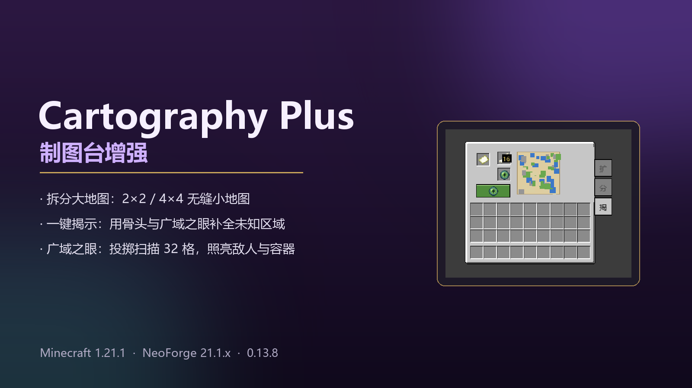
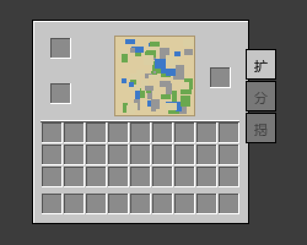
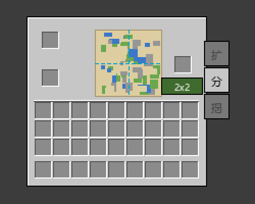
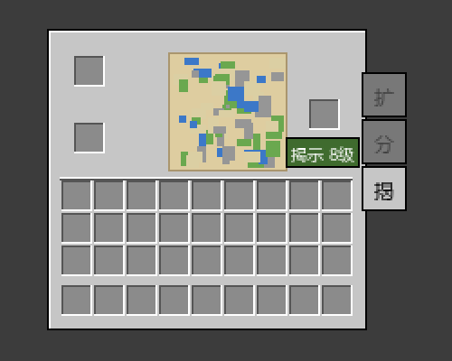
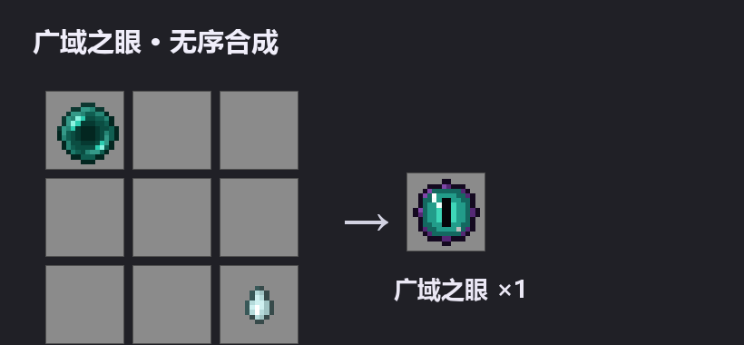

# Cartography Plus · 制图台增强


把原版制图台变成真正好用的工具：**拆分大地图**、**一键揭示未知区域**，外加一个能扫描周围的小道具「广域之眼」。

原版那一页一点没动，新功能全部挂在右侧的书签上。



---

## 功能

### 拆分地图

把 2048×2048 的大地图切成 **2×2** 或 **4×4** 张无缝小地图。

- 地图 + 纸，纸的消耗：2×2 需要 1 张，4×4 需要 2 张
- 预览上会显示青色虚线网格，右上角两个小书签切换档位
- 只有**取走结果**时才真正消耗材料
- 产出地图命名规则：`#原图ID 列,行`，例如 `#235 1,1`

### 揭示未知区域

不用亲自跑图，用骨头和广域之眼把整张地图补全成彩色。

- 三槽布局：地图 / 骨头 / 眼睛，空槽有半透明虚影提示
- 骨头消耗按地图等级递增：

| 地图等级 | 尺寸 | 骨头 |
|---|---|---|
| 0 | 128×128 | 4 |
| 1 | 256×256 | 8 |
| 2 | 512×512 | 16 |
| 3 | 1024×1024 | 32 |
| 4 | 2048×2048 | 64 |

- **不消耗经验**，只消耗骨头和 1 个广域之眼
- 结果是**独立副本**（新地图 ID），不会改到背包里的原图
- 同时只能进行一张地图的揭示
- 关闭界面时，槽内剩余物品自动退回背包

### 广域之眼

新物品，末影珍珠 + 恶魂之泪（无序合成）。

- **揭示**：放在揭示页的眼睛槽里作为消耗品
- **投掷扫描**：手持右键丢出，落地扫描周围 **32 格**，敌对生物发光、箱子/木桶/末影箱显示轮廓，持续 30 秒，不会传送

---

## 截图

| 扩大（原版） | 拆分 |
|---|---|
|  |  |

| 揭示（改版三槽） | 合成 |
|---|---|
|  |  |

---

## 安装

1. 安装 **Minecraft 1.21.1** + **NeoForge 21.1.x**
2. 把 `cartographyplus-x.y.z.jar` 放进 `.minecraft/mods`
3. 启动游戏，制图台界面就会变成三页

无前置依赖。客户端和服务端都建议安装（服务端决定揭示行为）。

卸载：删掉 jar 即可，已揭示的地图会变回未探索状态，但不会损坏存档。

---

## 从源码构建

```bash
git clone https://github.com/TheDoom0019/CartographyPlus.git
cd CartographyPlus
./gradlew build
# 产物：build/libs/cartographyplus-x.y.z.jar
```

需要 JDK 21。国内网络如果拉不到 NeoForge 依赖，可用项目里的 `mirror.init.gradle`：

```bash
./gradlew --init-script mirror.init.gradle build
```

---

## 已知问题

- **揭示较慢**：最大地图有 16384 个区块，实测需要 3~5 分钟，期间会占用较多 CPU
- 揭示页原版结果槽不可见，但仍占着槽位
- 拆分只支持 2×2 / 4×4（2 的幂）

---

## 反馈

遇到问题请开 issue，附上：

- Minecraft / NeoForge 版本
- 完整日志（`logs/latest.log`）
- 复现步骤

---

## 许可证

[MIT](LICENSE) © 2026 MCM

---

## English

**Cartography Plus** turns the vanilla cartography table into a real tool:

- **Split** a 2048×2048 map into seamless 2×2 / 4×4 tiles (map + paper)
- **Reveal** unexplored areas with bones + a Wide Eye (no XP cost)
- **Wide Eye** — a throwable item (ender pearl + ghast tear) that scans a 32 block radius, glowing hostiles and outlining containers

Requires Minecraft 1.21.1 and NeoForge 21.1.x. No dependencies.
Build with `./gradlew build` (JDK 21).